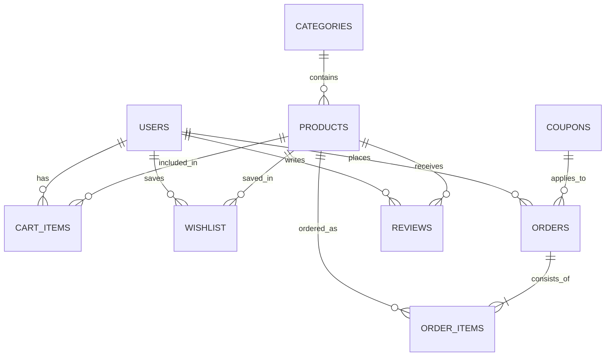

# 🛒 Kishore Kumar Mart

> **Full-Stack Online Supermarket & Grocery E-Commerce Platform**  
> *Developed for Academic Submission / College Mini & Major Project*


---

## 📖 1. Project Description

**Kishore Kumar Mart** is an end-to-end, full-stack online supermarket and grocery e-commerce web application. The platform connects customers directly with fresh farm produce, dairy, bakery essentials, foodgrains, household items, and personal care goods.

The project features a **Model-View-Controller (MVC)** architecture, a relational **SQLite database** with zero-configuration setup, JWT-based role authentication (Customer vs. Administrator), responsive client interfaces, interactive shopping carts, promo coupon validation, scheduled delivery slot booking, and a live visual order-lifecycle tracking stepper.

---

## ✨ 2. Key Features

### 👤 Customer Features
* **Authentication & Profiles**: Secure user registration, password hashing (bcrypt), JWT session management, profile editing.
* **Smart Catalog & Navigation**: 6 pre-configured grocery departments (Fruits & Vegetables, Dairy & Bakery, Foodgrains & Oils, Snacks & Beverages, Cleaning & Household, Personal Care).
* **Live Autocomplete Search & Filters**: Instant debounced search by name/tags, category pills, price range filtering, and stock availability toggles.
* **Product Detail & Reviews**: High-resolution image zoom, nutritional pack units, real-time stock levels, customer reviews, and interactive 5-star rating submission.
* **Dynamic Shopping Cart**: Slide-out cart drawer, reactive quantity counters (+/-) with live stock protection, free-shipping threshold meter, and promo coupon application.
* **Wishlist**: One-click heart toggle to save favorite products for future shopping.
* **Multi-Step Checkout**:
  * Step 1: Pre-filled recipient contact and address details.
  * Step 2: Preferred delivery slot selection (Morning, Afternoon, Evening, or Express 60-Min).
  * Step 3: Payment method choice (Cash on Delivery, UPI / QR Code, Debit/Credit Card).
* **Live Order Lifecycle Tracking**: Visual 5-stage progress stepper (`Placed` → `Confirmed` → `Packed` → `Out for Delivery` → `Delivered`) and public order number lookup.

### 🛡️ Store Manager & Admin Features
* **Executive KPI Dashboard**: Live sales revenue counter, total order count, pending deliveries, inventory numbers, and customer counts.
* **Product Inventory Management (CRUD)**: Add new products with categories, units, regular & offer prices, stock alerts, and image URLs.
* **Stock Protection & Low-Stock Alerts**: Automatic inventory deduction on checkout and automated alerts for items with $\le 10$ units.
* **Order Fulfillment Workflow**: Real-time status transitions with dropdown sync.
* **Customer Directory**: View registered customer profiles, total orders, and cumulative expenditure.
* **Promotional Discount Coupons**: Create custom promo codes (e.g., `WELCOME10`, `MART20`) with percentage discounts and maximum savings caps.

---

## 🛠️ 3. Technology Stack

| Layer | Technology | Version | Purpose |
| :--- | :--- | :--- | :--- |
| **Runtime** | Node.js | `>= 18.x` (Recommended: v20 LTS) | Server-side JavaScript engine |
| **Framework** | Express.js | `^4.19.2` | REST API routes, middleware, static server |
| **Database** | SQLite3 | `^5.1.7` | Zero-configuration relational database |
| **Security** | bcryptjs | `^2.4.3` | Pure JavaScript password hashing (salt rounds: 10) |
| **Tokens** | jsonwebtoken | `^9.0.2` | Stateless JWT authentication & claims |
| **Middleware** | cors, dotenv | `^2.8.5`, `^16.4.5` | Cross-origin requests & environment variables |
| **Frontend** | HTML5, CSS3, ES6+ | Native Vanilla | Clean responsive UI without bulky dependencies |

---

## 📁 4. Project Structure

```
kishorekumarmart/
├── .env.example              # Environment variables template
├── .gitignore                # Git ignore patterns (node_modules, db, secrets)
├── package.json              # Project metadata, dependencies and scripts
├── server.js                 # Express server bootstrap and entry point
├── test/
│   └── api-test.js           # Automated end-to-end integration test suite
├── src/
│   ├── config/
│   │   └── database.js       # SQLite connection and promisified query helper
│   ├── controllers/
│   │   ├── adminController.js    # Store manager KPI, inventory, orders
│   │   ├── authController.js     # User registration, login, JWT issuance
│   │   ├── cartController.js     # Cart updates, subtotals, free delivery
│   │   ├── categoryController.js # Category listings
│   │   ├── couponController.js   # Coupon validation and calculations
│   │   ├── orderController.js    # Checkout, order placement, tracking
│   │   ├── productController.js  # Catalog search, filter, pagination
│   │   ├── reviewController.js   # Reviews and rating aggregation
│   │   └── wishlistController.js # Wishlist toggle and items
│   ├── middleware/
│   │   ├── authMiddleware.js     # JWT verification and Admin role guard
│   │   └── errorHandler.js       # Centralized error and 404 handlers
│   ├── models/
│   │   ├── schema.sql        # Relational schema DDL (9 tables + indexes)
│   │   ├── seed.js           # Automated seeder with realistic inventory
│   │   ├── userModel.js      # User queries
│   │   ├── productModel.js   # Product queries and stock management
│   │   ├── categoryModel.js  # Category queries
│   │   ├── cartModel.js      # Shopping cart operations
│   │   ├── orderModel.js     # Orders and transaction items
│   │   ├── couponModel.js    # Promo coupons
│   │   ├── reviewModel.js    # Reviews and rating recalculations
│   │   └── wishlistModel.js  # Saved favorites
│   └── routes/
│       ├── adminRoutes.js
│       ├── authRoutes.js
│       ├── cartRoutes.js
│       ├── categoryRoutes.js
│       ├── couponRoutes.js
│       ├── orderRoutes.js
│       ├── productRoutes.js
│       ├── reviewRoutes.js
│       └── wishlistRoutes.js
└── public/
    ├── index.html            # Main Storefront
    ├── product-detail.html   # Detailed Product Page & Reviews
    ├── checkout.html         # Multi-Step Checkout & Slots
    ├── orders.html           # Order History & Live Visual Tracker
    ├── wishlist.html         # Saved Favorites Page
    ├── admin.html            # Admin Management Portal
    ├── css/
    │   ├── style.css         # Main design system & responsive layout
    │   ├── admin.css         # Dedicated admin dashboard styling
    │   └── responsive.css    # Mobile and tablet breakpoints
    └── js/
        ├── api.js            # Standardized API client
        ├── auth.js           # Authentication & session coordinator
        ├── cart.js           # Reactive shopping cart & drawer
        ├── products.js       # Product grid, search, and category tabs
        ├── checkout.js       # Checkout form & payment processor
        ├── orders.js         # Order history & visual lifecycle tracker
        ├── wishlist.js       # Wishlist coordinator
        ├── admin.js          # Admin dashboard controller
        └── app.js            # Global toasts & navigation initialization
```

---

## 🗄️ 5. Database Schema & Architecture

The application uses an embedded relational database (`data/mart.db`) automatically generated from [`src/models/schema.sql`](file:///c:/kishorekumarmart/src/models/schema.sql) on initial boot:



### Tables Overview:
1. `users` (id, full_name, email, password_hash, phone, address, role, created_at)
2. `categories` (id, name, slug, icon, description, is_active)
3. `products` (id, category_id, name, slug, description, unit, price, discount_price, stock_quantity, image_url, rating, reviews_count, is_featured, is_active, created_at)
4. `cart_items` (id, user_id, product_id, quantity, created_at)
5. `wishlist` (id, user_id, product_id, created_at)
6. `coupons` (id, code, discount_percent, max_discount, min_order_amount, is_active, created_at)
7. `orders` (id, order_number, user_id, total_amount, discount_amount, delivery_fee, final_amount, coupon_code, customer_name, customer_phone, delivery_address, delivery_slot, payment_method, payment_status, order_status, notes, created_at)
8. `order_items` (id, order_id, product_id, product_name, unit_price, quantity, subtotal)
9. `reviews` (id, product_id, user_id, user_name, rating, comment, created_at)

---

## 🚀 6. Installation & Setup Guide

### Prerequisites
* [Node.js](https://nodejs.org/) (Version 18.x or 20.x LTS)
* [Git](https://git-scm.com/)

### Step 1: Clone the Repository
```bash
git clone https://github.com/YOUR_USERNAME/kishorekumarmart.git
cd kishorekumarmart
```

### Step 2: Install Dependencies
```bash
npm install
```

### Step 3: Configure Environment Variables
Create a `.env` file from `.env.example`:
```bash
cp .env.example .env
```
*(Default settings work out of the box without changes!)*

### Step 4: Seed Database (Automatic or Manual)
Database tables and seed data are created automatically when the server boots. To manually reset or re-seed:
```bash
npm run seed
```

### Step 5: Run the Server
```bash
npm start
```

Open your browser and navigate to:
* **Storefront**: [http://localhost:3000](http://localhost:3000)
* **Admin Portal**: [http://localhost:3000/admin.html](http://localhost:3000/admin.html)

---

## 🔑 7. Default Credentials for Testing

| Role | Email | Password | Access Privileges |
| :--- | :--- | :--- | :--- |
| **Store Administrator** | `admin@kishorekumarmart.com` | `admin123` | Full Admin Portal, Products CRUD, Order Status, Metrics |
| **Demo Customer** | `customer@example.com` | `customer123` | Cart, Wishlist, Checkout, Order Tracking, Reviews |

### Active Promo Coupon Codes:
* `WELCOME10` — 10% OFF up to ₹100 on orders $\ge$ ₹300
* `MART20` — 20% OFF up to ₹150 on orders $\ge$ ₹500
* `SUPER50` — 15% OFF up to ₹50 on orders $\ge$ ₹250
* `FREESHIP` — ₹40 discount (covers delivery fee)

---

## 🧪 8. Automated Testing

The project includes an end-to-end integration test suite verifying all 13 core modules:
```bash
npm test
```
**Expected Output:**
```
====================================================
🧪 RUNNING KISHORE KUMAR MART AUTOMATED TEST SUITE
====================================================

✅ PASS: API Health Check 
✅ PASS: Admin Authentication (Role: admin)
✅ PASS: Customer Authentication (User: Rahul Sharma)
✅ PASS: Category Catalog Fetch (6 categories found)
✅ PASS: Product Search & Filter (Found: Fresh Alphonso Mangoes)
✅ PASS: Add Item to Shopping Cart 
✅ PASS: Coupon Code Validation & Discount (Saved: ₹98.8)
✅ PASS: Wishlist Toggle 
✅ PASS: Checkout & Order Placement (Order #KKM-XXXXX)
✅ PASS: Public Order Tracking 
✅ PASS: Customer Review & Rating Aggregation 
✅ PASS: Admin Dashboard Metrics Authorization 
✅ PASS: Admin Order Lifecycle Status Update 

====================================================
TEST SUMMARY: 13 PASSED | 0 FAILED
====================================================
```

---

## 📸 9. Application Screenshots

| Page | Description |
| :--- | :--- |
| **Storefront (`index.html`)** | Modern grocery homepage with category pills, search bar, active promotional banners, and responsive product cards with instant cart actions. |
| **Product Detail (`product-detail.html`)** | Pack size specifications, live inventory badges, nutritional highlights, customer feedback, and interactive 5-star review submission. |
| **Cart Drawer** | Slide-out cart with live quantity manipulation, free-shipping meter, and coupon verification. |
| **Multi-Step Checkout (`checkout.html`)** | Address entry, delivery time-slot booking (Morning / Afternoon / Evening / Express), and payment modes (COD, UPI, Card). |
| **Order History & Live Tracker (`orders.html`)** | Visual 5-stage lifecycle stepper (`Placed` → `Confirmed` → `Packed` → `Out for Delivery` → `Delivered`). |
| **Admin Portal (`admin.html`)** | Comprehensive dashboard with KPI metric cards, product inventory CRUD, status dropdown updater, and coupon manager. |

---

## 👥 10. Project Information & Academic Credits

* **Project Title**: Kishore Kumar Mart (Online Supermarket Management System)
* **Author / Developer**: Kishore Kumar
* **Degree**: Bachelor of Computer Applications (BCA) / B.Tech Computer Science & Engineering
* **Submission Year**: 2026
* **License**: MIT Open Source License
